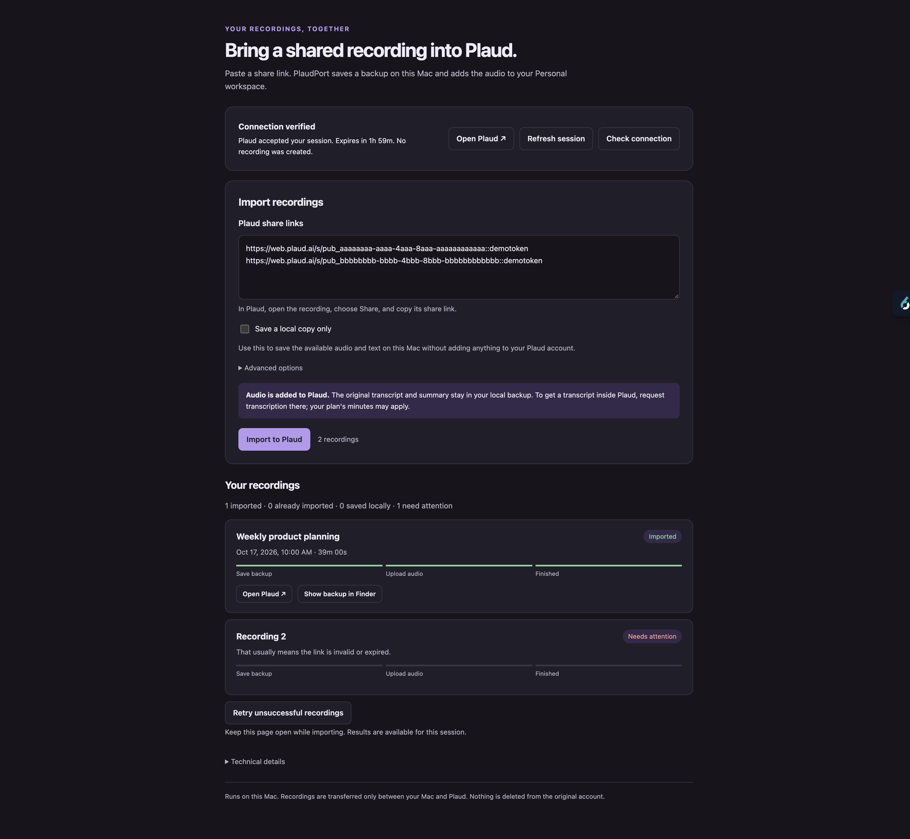

# PlaudPort

**Copy a shared Plaud recording into your own Plaud account.** Paste a share link
into a simple page on your Mac. PlaudPort saves a local backup and imports the
audio into your **Personal** workspace, keeping the recording's original title
and date. The original recording is never moved or deleted.

[Set up once](#set-up-once) · [Import a recording](#import-a-recording) ·
[Find your results](#find-your-results) · [Get help](#when-something-goes-wrong)



*Example interface using fictional recordings.*

## What gets copied?

| Item | Where it goes |
|---|---|
| Audio | Your Plaud Personal workspace and a backup on this Mac |
| Original title and recording date | Preserved in your imported Plaud recording |
| Original transcript and available summary | Saved in the local backup; they cannot be attached to the imported audio in Plaud |

**If you want a transcript inside Plaud, request transcription there after the
import. Your plan's transcription minutes may apply.**

## Before you start

You need:

- A Mac and Google Chrome, with access to your Plaud account.
- [Node.js 20 or newer](https://nodejs.org/en/download). Install the current LTS
  release if you do not already have Node.js.
- A PlaudPort folder saved somewhere permanent on your Mac. You can download
  this repository using GitHub's **Code → Download ZIP**, then unzip it.

Setup uses Terminal once. After that, you can launch PlaudPort from Finder and
import share links from its browser page. No separate hosting account is needed.

## Set up once

### 1. Install PlaudPort's dependencies and Chrome helper

Open **Terminal**. Type `cd ` (including the space), drag your PlaudPort folder
from Finder into Terminal, and press Return. This tells Terminal which folder
to work in. Then run these commands, one at a time:

```bash
npm install
npm run chrome:install
chmod +x Open-PlaudPort.command
```

The installer prints the full path to the Chrome extension folder. Keep that
Terminal window open for the next step. The helper and saved credentials live
in Application Support, outside your project folder.

### 2. Add the Chrome extension

1. Use the Chrome **profile where you sign in to Plaud**.
2. Type `chrome://extensions` into Chrome's address bar and press Return.
3. Turn on **Developer mode** and click **Load unpacked**.
4. Select the **chrome-extension** folder inside your PlaudPort folder. Choose
   the folder itself, not one of the files inside it.
5. In Chrome's **Extensions** menu (the puzzle-piece icon), pin
   **PlaudPort credential sync** so its status badge is visible.
6. Open [Plaud](https://web.plaud.ai/), sign in, choose your **Personal**
   workspace, and reload the Plaud page. The extension badge should show green
   **OK**, meaning your session was saved on this Mac.

The extension refreshes PlaudPort's saved credentials while you use Plaud. You do
not need to copy tokens, edit configuration files, or open developer tools.

### 3. Open PlaudPort and check the connection

In Finder, double-click **Open-PlaudPort.command** inside your PlaudPort folder.
A Terminal window starts the local server and opens the page in your browser.
Leave that window running while you use PlaudPort.

If double-clicking does not launch it, return to Terminal in your PlaudPort
folder and run:

```bash
npm start
```

Click **Check connection** on the page. **Connection verified** means Plaud
accepted your saved session. This check creates no recording. A saved session
on its own is not proof that Plaud accepts it.

You can also launch without automatically opening a browser using `npm run web`,
then open the address it prints (normally `http://127.0.0.1:4317`).

## Import a recording

1. In Plaud, open the shared recording, choose **Share**, and copy its share link.
2. Paste the full link into PlaudPort. For several recordings, put **one link on
   each line**.
3. Click **Import to Plaud**.
4. Keep the page open while PlaudPort saves the backup and uploads the audio.
   Each recording has its own progress and result.

To save available audio and text on your Mac without adding a recording to
Plaud, select **Save a local copy only**. This works without signing in.

Recordings already imported through PlaudPort are normally skipped. Creating an
additional copy is an optional setting under **Advanced options**.

## Find your results

- **Imported:** the audio is in your Plaud Personal workspace. Use **Open Plaud**
  and find it by its title and original recording date. The link opens Plaud's
  home page, not a recording-specific page.
- **Already imported:** PlaudPort found its previous import and avoided making
  another copy.
- **Saved on this Mac:** your local backup is available, but no new recording
  was added to Plaud.
- **Needs attention:** read the message on that recording's card. After fixing
  the problem, choose **Retry unsuccessful recordings**; successful items are
  not submitted again.

**Show backup in Finder** opens that recording's backup folder. Look for
`recording.md` to read its available transcript and summary, or `audio.mp3` for
the audio. Backups are under `data/shares/` inside your PlaudPort folder.

If a share has no accessible audio, PlaudPort saves the text it can retrieve and
explains that result. Technical logs are available under **Technical details**.
Result cards are kept only for the current page session; the files remain on
disk after you close the page.

When finished, press **Control-C** in the PlaudPort Terminal window to stop it.
Closing the browser page alone does not stop the server.

## When something goes wrong

| What you see | What to do |
|---|---|
| Connect your Plaud account / session expired | Open Plaud in Chrome, sign in to Personal, reload Plaud, then click **Refresh session** and **Check connection** in PlaudPort. |
| Green extension badge, but connection not verified | The badge confirms a local save. **Check connection** verifies the session with Plaud. |
| Orange **!** on the extension | Click its icon for a diagnostic message. See the [Chrome troubleshooting guide](docs/CHROME-AUTH.md#troubleshooting). |
| Browser cannot reach PlaudPort | Start the launcher again and keep its Terminal window running. |
| Address already in use | Another server is using that address. Use the existing PlaudPort tab if it is already running, or stop the other server and relaunch. |
| Progress connection interrupted | Keep the page open while it reconnects. The import may still be running; avoid submitting the same links again. |
| A recording needs attention | Read its card, fix the issue, then retry unsuccessful recordings. |
| Audio download failed | The available text is backed up, but no audio was imported. Check your connection, then retry unsuccessful recordings. |
| Plaud may already have this recording / no recording ID returned | Confirmation was uncertain. Check your Personal workspace by title and original date before doing anything else. Automatic retries are blocked to prevent duplicates, even with the extra-copy option. See below. |

For an uncertain confirmation, keep the backup. After checking Plaud, an advanced
user can reconcile its `manifest.json`: if the recording exists, record its
`importedFileId` and remove `importConfirmationPending`; if it definitely does not
exist, remove only `importConfirmationPending` and retry. Do not clear this guard
while the result is unknown.

The Plaud session usually expires after about a day. If Chrome has been idle,
reload your signed-in Plaud page before importing. This tool does not sign in
for you when Chrome is closed or your Plaud session has ended.

## Updating PlaudPort

After updating your project files:

1. Run `npm install` in your PlaudPort folder.
2. Run `npm run chrome:install` to update the installed helper copy. Also do this
   after upgrading Node.js.
3. At `chrome://extensions`, click the extension's **reload ↻** button.
4. Stop the running PlaudPort server with Control-C and start the launcher again.
5. Reload Plaud in Chrome, then check the connection in PlaudPort.

## Other uses and technical information

- **Gong downloads and audio/video files:** supported through Terminal, not yet
  through the web page. See the [terminal guide](docs/CLI.md) and [Gong guide](docs/GONG.md).
  Conversion of non-MP3 files requires FFmpeg; the Gong guide covers setup.
- **Team migration:** experimental research, not an everyday user feature.
  See the [migration plan](docs/PRD.md).
- **Configuration, scripts, and roadmap:** [Advanced documentation](docs/ADVANCED.md).
- **Chrome helper details and removal:** [Chrome setup guide](docs/CHROME-AUTH.md).
- **Testing and contributing:** [Testing](docs/TESTING.md) · [Contributing](CONTRIBUTING.md).

PlaudPort runs on your Mac. Recordings travel only between your Mac and Plaud;
there is no hosted PlaudPort service. Credentials stay in an owner-only file in
`~/Library/Application Support/PlaudPort/`, and your local backups are excluded
from Git. This is an unofficial integration that may need updates when Plaud
changes. See [Security](SECURITY.md) for details.

Chrome credential capture, authentication, and a share-link import were verified
live on 2026-10-17. The web UI uses the same import pipeline as the Terminal commands.

MIT license — see [LICENSE](LICENSE).
